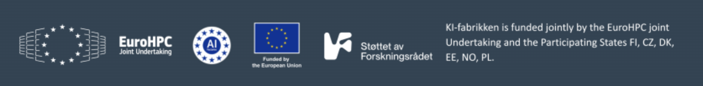

# Building LLM Agents: a hands-on course

Ten notebooks that take you from your first call to a language model to a
multi-agent system you orchestrate yourself, plus an extra notebook on a second
kind of model. Every concept is built from scratch in plain Python, with no agent
framework, so you can see what actually happens underneath tools like LangGraph,
CrewAI and the OpenAI Agents SDK.

The course is taught live at Sigma2, and these are the notebooks from it. They
also work for self-study: each one explains itself as you run it, top to bottom.

---

## The curriculum

The course is one continuous arc. Each notebook builds on the one before it.

| # | Notebook | What you learn to do |
|---|----------|----------------------|
| 01 | `01_first_llm_call.ipynb` | Call the model, and understand messages and roles, temperature, streaming, tokens, and why LLMs are stateless. |
| 02 | `02_prompting_and_structured_output.ipynb` | Write prompts that behave, and get reliable JSON out. This is what turns a chatbot into a building block. |
| 03 | `03_tool_calling.ipynb` | Give the model hands: define tools and let it call your code. This is the pivotal idea of the course. |
| 04 | `04_your_first_agent.ipynb` | Put tool calling in a loop: reason, act, observe. This is an agent. |
| 05 | `05_memory_and_context.ipynb` | Manage the context window with conversation buffers, summarisation, and lexical retrieval. |
| 06 | `06_a_useful_single_agent.ipynb` | Make one agent robust: a real toolbox, error recovery, sandboxing, and guardrails. |
| 07 | `07_multi_agent_basics.ipynb` | Why and how to use several agents: specialised roles, handoffs, and the generator/critic pair. |
| 08 | `08_orchestration_patterns.ipynb` | The core patterns: pipeline, router, orchestrator-worker, and parallel fan-out. |
| 09 | `09_advanced_orchestration.ipynb` | Dynamic control flow: planner-executor, reflection loops, and the supervisor. |
| 10 | `10_capstone.ipynb` | Assemble a multi-agent research assistant end to end, and cover what it takes to run agents in production. |
| 11 | `11_a_model_that_decides.ipynb` | Extra, after the capstone. Use a decision model, Clef, as a router, a critic gate and a guardrail, and know when to fall back to the chat model. |

The mental model that ties it together: an agent is an LLM plus a role plus tools
plus a loop. Multi-agent means several of those, where each one's output feeds the
next. Orchestration is deciding who runs when. The rest is detail.

---

## Setup

### 1. Get the code and a Python environment

```bash
git clone https://github.com/basir-sigma2/building-llm-agents.git
cd building-llm-agents
python3 -m venv .venv
source .venv/bin/activate          # Windows: .venv\Scripts\activate
pip install -r requirements.txt
```

### 2. Add your API key

```bash
cp .env.example .env
```

Then edit `.env`:

```
OPENAI_API_KEY=<your Sigma2 AI Gateway key>
OPENAI_BASE_URL=https://ai-gateway.sigma2.no/v1
```

The notebooks call the Sigma2 AI Gateway, an OpenAI-compatible endpoint, so the
standard `openai` client works against it. The shared key handed out in class
stops working after the course. To keep going, ask for AI Gateway access for
your own Sigma2 project. The `.env` file is git-ignored, so your key stays out of
any commit.

### 3. Launch Jupyter

```bash
jupyter lab
```

Open `notebooks/01_first_llm_call.ipynb` and run the cells from top to bottom.

---

## Layout

```
building-llm-agents/
├── notebooks/
│   ├── 01_first_llm_call.ipynb … 10_capstone.ipynb   # the course, in order
│   ├── 11_a_model_that_decides.ipynb                 # extra: the decision model
│   ├── helpers.py        # shared connection, Agent/Tool (built in nb 04), decide() (nb 11)
│   ├── agent_workspace/  # the sandbox notebook 06's agent reads and writes
│   └── figures/          # diagrams for the notebooks (see figures/FIGURES.md)
├── requirements.txt
├── .env.example          # copy to .env and fill in
└── LICENSE               # CC BY 4.0
```

`helpers.py` keeps the teaching code clean. From notebook 02 onward you write
`from helpers import client, MODEL` instead of repeating the connection
boilerplate. The `Agent` and `Tool` classes it contains are the same ones you
build by hand in notebook 04. Nothing is hidden.

---

## Good to know

- The model behind the gateway is a *reasoning* model: left alone it thinks
  before answering, and that thinking counts against `max_tokens`. `helpers.py`
  switches it off with `reasoning_effort="none"` on every call and budgets 8000
  tokens, so cells return promptly. The note at the top of `helpers.py` explains
  both, and shows how to switch thinking back on. If you build a client by hand
  and get an empty answer, this is why.
- The course uses whichever chat model your key reaches (notebook 01 lists them).
  Set `COURSE_MODEL` in `.env` to pin one. Notebooks 01 to 10 rely only on
  standard features: chat completions, tool calling and JSON mode. Notebook 11
  also needs Clef (`clef-flash-not-for-production`) on your key.
- The notebooks are written for and tested against the Sigma2 AI Gateway. Another
  OpenAI-compatible endpoint may work, but not every server accepts
  `reasoning_effort="none"`.
- A single call is cheap, but agents loop and resend their whole history on each
  step, so token usage adds up fast. Notebook 10 shows how to track it.

By notebook 10 you will have built a working multi-agent system from first
principles.

---

## License

This course is part of the [LUMI AI Factory](https://lumi-ai-factory.eu/), and is
licensed under [CC BY 4.0](LICENSE). You may share and adapt it for any purpose,
as long as you give credit:

> *Building LLM Agents*, LUMI AI Factory (https://lumi-ai-factory.eu/), CC BY 4.0


